<div align="center">

# OpenCode Mobile

**A modern, production-ready native Android client for [OpenCode Go](https://opencode.ai/docs/console/go/).**  
Chat with GLM, Kimi, DeepSeek, Qwen, MiniMax, and more directly from your Android device in OpenCode's signature monochrome monospace design.

Created & developed by **[Mrinall Samal](https://github.com/MrinallSamal-byte)**


[](https://github.com/MrinallSamal-byte/opencode-mobile/releases/latest)
[](https://github.com/MrinallSamal-byte/opencode-mobile/releases/latest)
[](LICENSE)

<br/>

### 📲 [**Download Latest APK (Direct Download)**](https://github.com/MrinallSamal-byte/opencode-mobile/releases/latest/download/OpenCodeMobile-v1.0.1.apk)
*Ready to install on any Android phone running Android 8.0 or newer (No Google Play required).*

<br/>

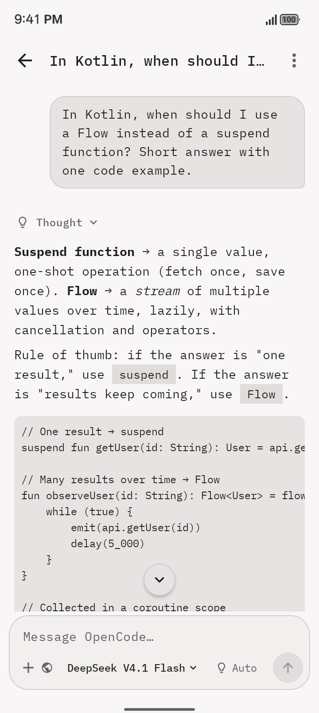&nbsp;
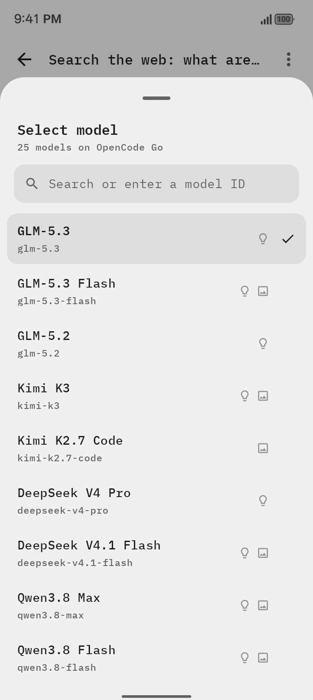&nbsp;
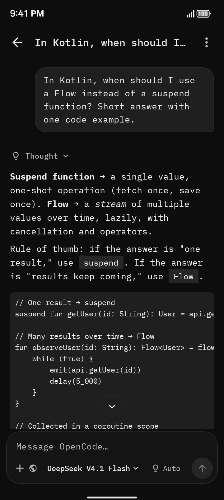

</div>

---

## Contents

- [Direct APK Download](#direct-apk-download)
- [Key Features](#key-features)
- [Visual Tour](#visual-tour)
- [Quick Start Guide](#quick-start-guide)
- [Releases & Checksums](#releases--checksums)
- [User Guide](#user-guide)
- [Building from Source](#building-from-source)
- [Configuration & Settings](#configuration--settings)
- [Privacy & Security](#privacy--security)
- [Architecture & Tech Stack](#architecture--tech-stack)
- [Troubleshooting](#troubleshooting)
- [Contributing](#contributing)
- [Author & Credits](#author--credits)
- [License](#license)

---

## Direct APK Download

You can download and install the pre-compiled Android APK directly without needing Android Studio or the Google Play Store:

| Download Option | Link | Description | Size |
| :--- | :--- | :--- | :--- |
| **Direct APK Download** | [**Download OpenCodeMobile-v1.0.1.apk**](https://github.com/MrinallSamal-byte/opencode-mobile/releases/latest/download/OpenCodeMobile-v1.0.1.apk) | Direct installable APK file | ~2.1 MB |
| **GitHub Releases Page** | [**Browse Releases**](https://github.com/MrinallSamal-byte/opencode-mobile/releases/latest) | Release notes, changelog & checksums | — |

### How to Install the APK on Android:
1. **Download:** Tap the direct download link above on your Android device (or scan the QR code in Releases).
2. **Allow Installation:** If prompted by Android or your browser, enable **"Allow from this source"** or **"Install unknown apps"**.
3. **Open & Install:** Tap the downloaded `.apk` file and select **Install**.
4. **Launch & Connect:** Open OpenCode Mobile, enter your OpenCode Go API key in Settings, and start chatting immediately!

> [!TIP]
> **Installing via ADB from a computer:**  
> Connect your phone via USB with USB debugging enabled, then run:  
> ```bash
> adb install OpenCodeMobile-v1.0.1.apk
> ```

---

## Key Features

OpenCode Mobile brings desktop-grade developer productivity to Android with a clean, distraction-free interface:

- **⚡ Real-time SSE Streaming Chat:** Ultra-low latency streaming with markdown rendering (code blocks, markdown tables, blockquotes, lists, links, emphasis).
- **📋 Interactive Code Blocks:** Syntax-styled code containers with language badge, 1-tap copy, animated checkmark confirmation, and horizontal scrolling.
- **🔍 Real-Time Chat Search & Filter:** Instant live filtering across your entire chat history by conversation title, model name, or message snippet.
- **📤 Full Conversation Export & Share:** Share any chat formatted as clean Markdown or plain text via the Android share sheet, or copy with one tap.
- **🧠 Custom Instructions / System Prompt:** Set global persona, coding style preferences, and response constraints in Settings that automatically apply across all conversations.
- **✏️ Rename & Fork Conversations:** Rename chats with custom titles and branch / duplicate any chat to test alternative prompts or explore different directions.
- **🔄 Edit & Resend Messages:** Tap the edit icon on any previous user message to reload it into the composer and resend; subsequent turns are trimmed cleanly.
- **⏱️ Generation Latency & Word Count Metrics:** Transparent performance tracking displaying elapsed response duration (e.g. `1.8s`), total word count, and model attribution pills.
- **⚡ Quick Model Switcher:** 1-tap suggestion chips (`GLM-5.3`, `DeepSeek V4 Pro`, `Qwen3.8 Max`, `Kimi K3`, `MiniMax M3.1 Flash`) for instant switching without searching.
- **📳 Tactile Haptic Feedback:** Subtle, premium haptic feedback on message send, stop, stream completion, and copy actions (configurable in Settings).
- **🌐 Dual-Engine Live Web Search:** DuckDuckGo and Brave Search integration that browses the live web and cites source URLs with zero external search API keys required.
- **💻 App-Private Local Shell:** Run sandboxed `/system/bin/sh` commands in an isolated app workspace with process timeout limits and output streaming.
- **🔒 Android Keystore Encryption:** API keys are encrypted at rest using AES-256-GCM backed by hardware Keystore keys with automatic corruption recovery.
- **🖼️ Multi-Modal Media Support:** Image and audio input support with memory-efficient downsampling and broken-media fallback placeholders.
- **📊 Go Usage Dashboard:** Live monitoring of your 5-hour rolling, weekly, and monthly OpenCode Go quotas with reset countdown timers.
- **🎨 Responsive Theming:** System, Light, and Dark mode palettes set in [IBM Plex Mono](https://github.com/IBM/plex).

## Visual Tour

### Chat

<table>
  <tr>
    <td align="center">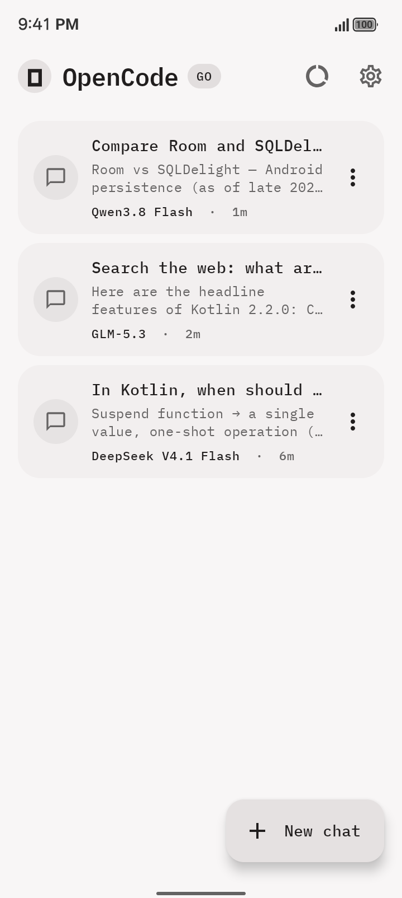</td>
    <td align="center">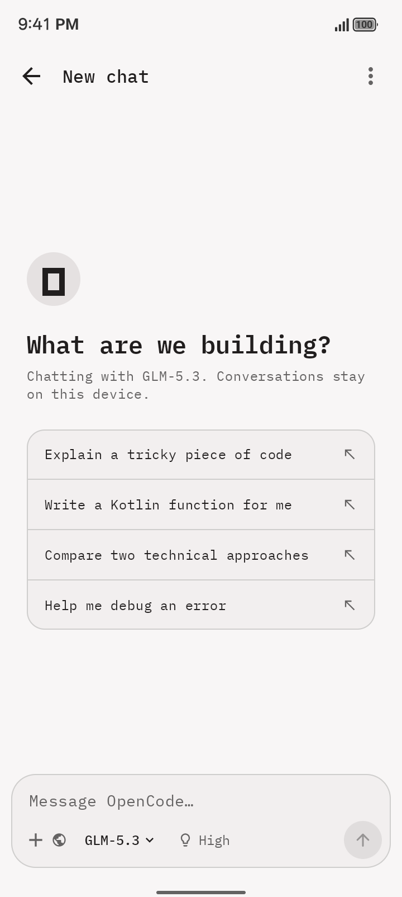</td>
    <td align="center">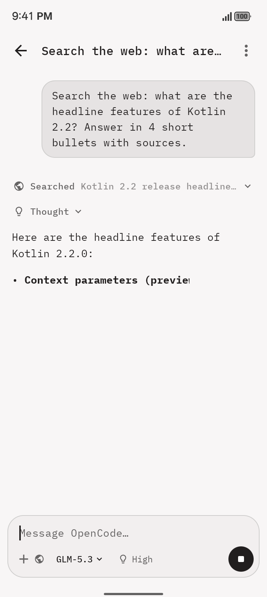</td>
  </tr>
  <tr>
    <td align="center"><sub>Conversations, newest first</sub></td>
    <td align="center"><sub>Start a chat or pick a suggestion</sub></td>
    <td align="center"><sub>Responses stream in live; tap ■ to stop</sub></td>
  </tr>
</table>

### Reasoning, tools and model controls

<table>
  <tr>
    <td align="center">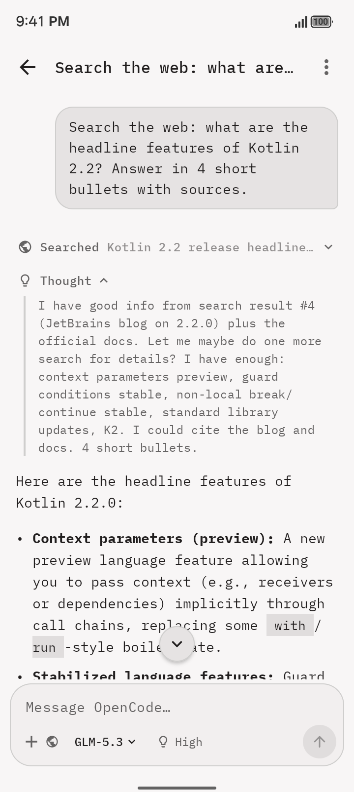</td>
    <td align="center">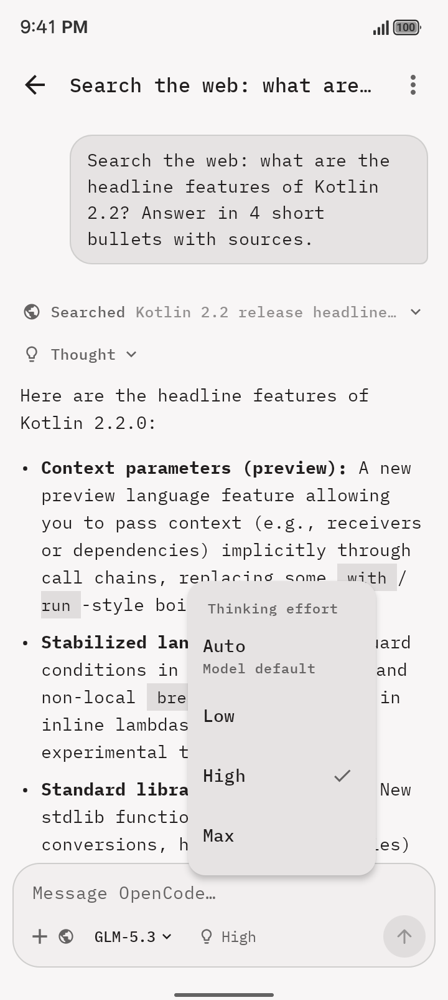</td>
    <td align="center">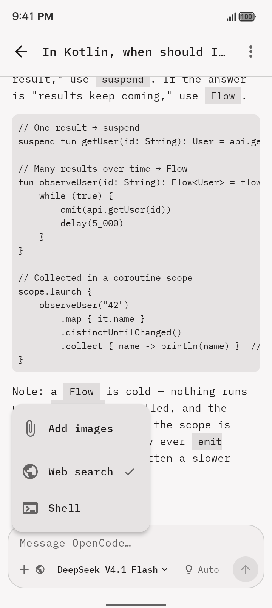</td>
  </tr>
  <tr>
    <td align="center"><sub>Expand any step to read the reasoning or tool output</sub></td>
    <td align="center"><sub>Effort levels offered by the current model</sub></td>
    <td align="center"><sub>Attach media and toggle tools per chat</sub></td>
  </tr>
</table>

### Usage, settings and dark mode

<table>
  <tr>
    <td align="center">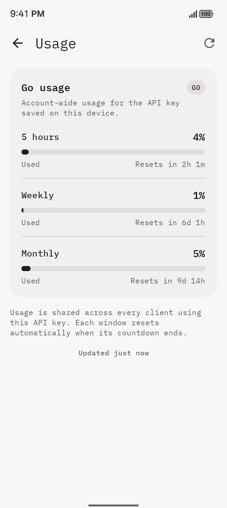</td>
    <td align="center">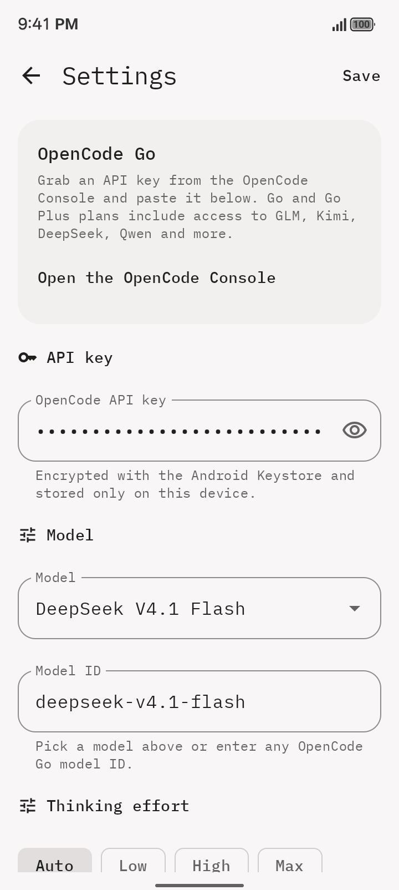</td>
    <td align="center">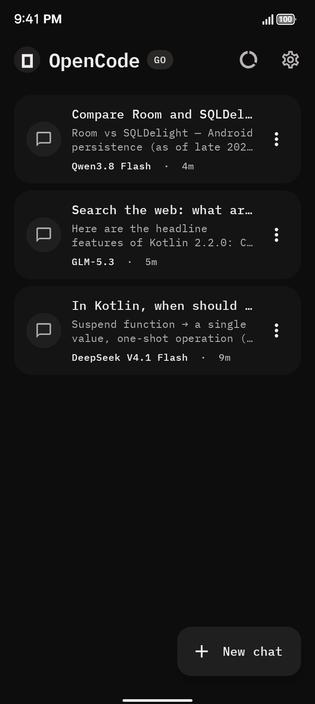</td>
  </tr>
  <tr>
    <td align="center"><sub>Rolling plan limits with reset countdowns</sub></td>
    <td align="center"><sub>API key, defaults, endpoint and theme</sub></td>
    <td align="center"><sub>Dark theme</sub></td>
  </tr>
</table>

## Quick Start Guide

### Requirements

- An Android phone or tablet running **Android 8.0 (API 26)** or newer.
- An **OpenCode Go** or **Go Plus** subscription, and an API key from the [OpenCode Console](https://opencode.ai/console).

### Direct Installation

1. **Download:** Tap **[Download OpenCodeMobile-v1.0.1.apk](https://github.com/MrinallSamal-byte/opencode-mobile/releases/latest/download/OpenCodeMobile-v1.0.1.apk)** directly to your Android device.
2. **Install:** Open the downloaded `.apk` file. If prompted by Android, tap **Settings** and toggle **Allow from this source**.
3. **Finish:** Tap **Install** and then **Open**.

> [!NOTE]
> To install from your computer over USB, run:
> ```bash
> adb install -r OpenCodeMobile-v1.0.1.apk
> ```

### First Run & Setup

1. Open OpenCode Mobile and tap **Add your API key to get started**, or the ⚙ icon in the top right.
2. Paste your OpenCode API key and tap **Save**.
3. Tap **Test connection** to verify that your key and inference endpoint are communicating properly.
4. Return to the main screen, tap **New chat**, and start exploring!

## Releases & Checksums

Official release APKs are hosted on the GitHub Releases page with SHA-256 checksums and release changelogs:

| Version | Release Date | Direct Download | Status | Highlights |
| :--- | :--- | :--- | :--- | :--- |
| **v1.0.1** | 2026-10-20 | [**Download APK (2.1 MB)**](https://github.com/MrinallSamal-byte/opencode-mobile/releases/latest/download/OpenCodeMobile-v1.0.1.apk) | Latest Stable | Production-ready release, real-time search, code copy, markdown export, forking, latency metrics, tactile haptics |

### Checksum Verification

Verify the integrity of your downloaded APK:

```bash
# macOS / Linux
shasum -a 256 OpenCodeMobile-v1.0.1.apk

# Windows (Command Prompt / PowerShell)
certutil -hashfile OpenCodeMobile-v1.0.1.apk SHA256
```

Verify signature using the Android SDK build tools:
```bash
apksigner verify --print-certs OpenCodeMobile-v1.0.1.apk
```

### Updating

You can install new APK versions directly over your existing installation. Your conversations, models, and custom settings will be preserved.

## User Guide

| To… | Do this |
| --- | --- |
| Start a conversation | Tap **New chat** on the home screen. The first message becomes the title. |
| Search conversations | Type in the search field in the chat list to filter by title, model, or message snippet. |
| Switch model | Tap the model name in the composer, pick from popular model chips, or search. Icons show thinking (💡), image and audio support. |
| Use a model that isn't listed | Type its ID in the model search box and tap **Use "…"**. |
| Change thinking effort | Tap the 💡 chip next to the model name. It's hidden for models with no effort options. |
| Turn web search or shell on or off | Tap **+** in the composer. Active tools appear as icons next to the **+**. |
| Attach images or audio | Tap **+** then **Add images** (or audio). This only appears when the model accepts that media. |
| Inspect reasoning or tool output | Tap a **Thought**, **Searched** or **Ran** row. |
| Copy code from blocks | Tap **Copy** in the header bar of any code block for instant 1-tap clipboard copying with language label. |
| Copy a response | Tap the copy icon under the answer. Also view response duration (e.g. `1.8s`) and word count. |
| Edit & resend a message | Tap the edit icon under any past user message to load it into the composer and resend. |
| Rename or duplicate a chat | Tap ⋮ on a chat in the list or in the chat screen → **Rename** or **Duplicate / Fork**. |
| Export or share a chat | Tap ⋮ in a chat or on a chat in the list → **Share as Markdown** or **Copy as Markdown**. |
| Set custom system instructions | Open **Settings** → **Custom instructions** to set instructions applied to all conversations. |
| Stop or retry | Tap ■ while streaming. If a request fails, tap **Try again**. |
| Check plan usage | Tap the usage ring on the home screen, or ⋮ → **Usage** in a chat. |
| Delete a chat | Tap ⋮ on the chat in the list, or ⋮ → **Delete chat** inside it. |

Model, effort and tool choices are saved per conversation. Defaults for new chats are set in **Settings**.

### Tools

- **Web search** is on by default for new chats. The model calls `web_search`, and the app queries DuckDuckGo and Brave Search (falling back to DuckDuckGo Instant Answers) to return live titles, URLs and snippets without requiring any search API keys. The model is told to avoid duplicate searches. After five tool rounds, the app asks for a final answer with tools disabled, so a chat can't loop forever.
- **Shell** is off by default and needs confirmation to enable. The model can call `shell`, which runs `/system/bin/sh` in the app-private `workspace` directory. Each command has a 20-second timeout, output is capped at 16,000 characters, and the exit code is reported. Android doesn't ship `bash`, `git`, `python` or `curl`.

### Attachments

Images are resized and compressed, then sent as `image_url` data URLs. WAV and MP3 audio is sent as `input_audio`. Attachments are stored in app-private storage and deleted together with their conversation. If you switch a chat to a model with different media support, attachments it can't read stay visible in the history but are left out of requests.

## Building from source

### Prerequisites

| Tool | Version |
| --- | --- |
| JDK | 17 or newer |
| Android SDK | Platform 36 (compile and target), build-tools 36 |
| Gradle | 8.14.3 (via the included wrapper) |
| Android Gradle Plugin | 8.13.2 |
| Kotlin | 2.2.10 |

Open the project in Android Studio, or point `local.properties` at your SDK:

```properties
sdk.dir=/path/to/Android/sdk
```

### Debug build

```bash
./gradlew :app:assembleDebug
# Output APK: app/build/outputs/apk/debug/app-debug.apk (~20 MB)

# Direct install to a connected Android phone:
adb install -r app/build/outputs/apk/debug/app-debug.apk
```

### Tests

```bash
./gradlew :app:testDebugUnitTest
```

The unit test suite validates SSE parsing, polymorphic error payloads, DuckDuckGo & Brave web search parsing, model catalog resolution, chat history trimming, Markdown conversation export, and search filtering.

### Release build

Release builds are minified with R8, obfuscated, and resource-shrunk to ~2.1 MB:

```bash
./gradlew :app:assembleRelease
# Output APK: app/build/outputs/apk/release/app-release-unsigned.apk (~2.1 MB)
```

To sign automatically, add `keystore.properties` in the project root:

```bash
# One-time: generate a keystore outside the repository
keytool -genkeypair -v -keystore ~/.android/opencode-mobile-release.jks \
  -storetype PKCS12 -alias opencode-mobile -keyalg RSA -keysize 4096 -validity 10000
```

```properties
# keystore.properties
storeFile=/Users/you/.android/opencode-mobile-release.jks
storePassword=…
keyAlias=opencode-mobile
keyPassword=…
```

Then `./gradlew :app:assembleRelease` outputs the signed APK at `app/build/outputs/apk/release/app-release.apk`.

### Publishing a release

1. Bump `versionCode` and `versionName` in [`app/build.gradle.kts`](app/build.gradle.kts).
2. Build the signed APK and rename it `OpenCodeMobile-vX.Y.Z.apk`.
3. Create the GitHub release with its checksum in the notes:

   ```bash
   shasum -a 256 OpenCodeMobile-vX.Y.Z.apk
   gh release create vX.Y.Z OpenCodeMobile-vX.Y.Z.apk --title "vX.Y.Z" --notes-file notes.md
   ```

4. Add a row to the [Releases](#releases--checksums) table.

> [!IMPORTANT]
> A release-signed APK cannot be installed over a debug build because the signatures differ. If switching between them, uninstall the existing app first.

## Configuration & Settings

All configuration lives in **Settings**:

| Setting | Default | Notes |
| --- | --- | --- |
| API key | — | Encrypted with AES-256-GCM via Android Keystore. |
| Model | `glm-5.3` | Default for new chats. Any OpenCode Go model ID is accepted. |
| Thinking effort | Auto | Default for new chats. Auto omits `reasoning_effort`. |
| Custom instructions | — | Global system prompt prepended across all conversations. |
| Haptic feedback | Enabled | Tactile haptics on send, stop, stream finish, and code copy. |
| Base URL | `https://opencode.ai/inference/go/openai/v1` | Any OpenAI-compatible endpoint. **Reset URL** restores default. |
| Appearance | System | System, Light or Dark (AMOLED friendly). |

### How requests are made

- Chats are sent to `POST {baseUrl}/chat/completions` with `stream: true`, and parsed as server-sent events.
- When a chat's effort isn't Auto, it's sent as `reasoning_effort`.
- Each conversation sends a stable `x-opencode-session` header and a client-specific `User-Agent`, as OpenCode Go recommends.
- The Usage screen derives its endpoint from the base URL and uses the same API key.

### Supported models

The built-in catalog only lists models that work through OpenCode Go's OpenAI-compatible chat completions endpoint. Models served through other protocols, such as Claude Haiku and Gemini, are intentionally left out. Any other model ID can still be used through the model picker or Settings.

### Local development endpoints

Cleartext HTTP is only allowed for `localhost`, `127.0.0.1` and `10.0.2.2` (the emulator's host loopback), so you can point the app at a local proxy. Every other endpoint must use HTTPS.

## Privacy & Security

- **API key:** encrypted with an Android Keystore key and stored only on the device. It's only ever sent in the `Authorization` header to the endpoint you configure.
- **Conversations and attachments:** stored as files in app-private storage. They're excluded from Android cloud backups (`allowBackup="false"`) and deleted when you delete the chat or uninstall the app.
- **Network:** traffic goes only to your configured endpoint, to the usage endpoint, and, when web search is on, to Brave Search and DuckDuckGo. There's no analytics or telemetry.
- **Shell tool:** off by default, confirmed per chat, and limited to an app-private directory with the app's own permissions.

## Architecture & Tech Stack

A single-module Jetpack Compose app using MVVM, with no DI framework. A small app container wires the stores and clients together.

```text
app/src/main/java/com/opencode/mobile/
├── data/       Conversation and attachment storage, encrypted settings, model catalog
├── network/    OkHttp chat client, SSE parser, usage client, web search and shell tools
├── vm/         Chat, chat list, settings and usage view models (StateFlow)
└── ui/         Compose screens, composer, model picker, theme and typography
```

| Concern | Library |
| --- | --- |
| UI | Jetpack Compose, Material 3 (BOM 2026.03.00) |
| Networking | OkHttp 5 with a hand-written SSE parser |
| Serialization | kotlinx.serialization |
| Markdown | [multiplatform-markdown-renderer](https://github.com/mikepenz/multiplatform-markdown-renderer) |
| Concurrency | Kotlin coroutines and Flow |

## Troubleshooting

| Symptom | Fix |
| --- | --- |
| **Request failed** with a 401 | Check the API key in Settings and use **Test connection**. |
| **Request failed** with an unsupported model | The model may not be served through the OpenAI-compatible endpoint. Choose a model from the built-in list. |
| No attach option under **+** | The current model doesn't accept images or audio. Switch to a model with the image icon in the picker. |
| No effort chip | The model doesn't expose effort levels, so it always uses its default. |
| **Couldn't load usage** | Usage needs a valid OpenCode Go API key. With a non-OpenCode base URL, the app falls back to the default usage endpoint. Tap **Retry**. |
| Shell says a command isn't found | Android only ships a minimal `sh` toolbox. `bash`, `git`, `python` and `curl` aren't available. |

## Contributing

Issues and pull requests are welcome. Before opening a PR:

1. Run `./gradlew :app:testDebugUnitTest` and make sure it passes.
2. Match the existing code style: Kotlin official style, Compose, no new DI or architecture frameworks.
3. For UI changes, include before and after screenshots in light and dark themes.

## Author

- **Developer & Creator:** [Mrinall Samal](https://github.com/MrinallSamal-byte) ([samalmrinall9@gmail.com](mailto:samalmrinall9@gmail.com))

## License

OpenCode Mobile is open source under the [MIT License](LICENSE).  
Copyright © 2026 Mrinall Samal.

### Third-party

- [IBM Plex Mono](https://github.com/IBM/plex) is bundled under the SIL Open Font License 1.1. The license text is in [`app/src/main/assets/licenses/IBMPlexMono-OFL.txt`](app/src/main/assets/licenses/IBMPlexMono-OFL.txt).
- The OpenCode wordmark, colours and font choices were used as visual references.

> [!NOTE]
> OpenCode Mobile is an unofficial community project. It isn't affiliated with or endorsed by OpenCode.
